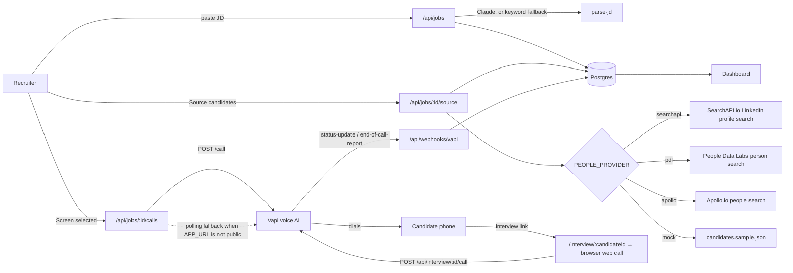

# AI Hiring Assistant

Paste a job description → source candidates → screen them with a
[Vapi](https://vapi.ai) voice agent, either in the candidate's browser via an interview
link or by phone → read the answers, recordings, and engagement on a dashboard.

Built as one app because Parts 1 and 2 of the assignment are the same product: an
AI-driven candidate reachout with a dashboard of responses. Part 3 is answered
[below](#part-3--tracking-attendance-for-1000-people-across-100-locations-without-smartphones).

---

## Architecture



**Why both webhooks and polling.** Vapi posts server messages to the assistant's
configured server URL, which needs a public HTTPS origin. On `localhost` there is nothing
to post to, so `GET /api/jobs/:id/calls` re-reads any in-flight call straight from Vapi
before returning. The dashboard works identically either way; it just tells you which mode
it is in.

### Data model

| Table | Purpose |
|---|---|
| `jobs` | Raw JD plus the parsed `title`, `company`, `location`, `seniority`, `skills[]` |
| `candidates` | Sourced people. Deduplicated per job on `(job_id, phone)` for candidates that have a number, and on a partial unique index `(job_id, linkedin) where linkedin is not null` for those that don't — Postgres treats NULLs as distinct, so the phone constraint alone stops deduplicating once `phone` is nullable. Either way, re-running sourcing is idempotent. |
| `calls` | One row per Vapi call, keyed by **Vapi's** call id — which makes duplicate callbacks idempotent without a mapping table. Holds status, extracted `result` JSON, recording URL, engagement, duration, and `webhook_events` (incremented only by the webhook route). |

---

## Setup

```bash
npm install
cp .env.example .env.local     # then fill it in — see the table below
npm run preflight              # verifies the Vapi key and assistant
npm run db:push                # applies schema.sql (idempotent)
npm run seed:agent             # prints VAPI_ASSISTANT_ID; paste it into .env.local
npm run preflight              # re-run: also confirms VAPI_ASSISTANT_ID resolves
npm run dev
```

Run `preflight` first. It checks the private key, that the assistant resolves, whether a
public key is set for interview links, and whether phone calling is configured.

Open https://ai-hiring-assistant-pearl.vercel.app/. The recruiter dashboard is
public — no password required.

With `PEOPLE_PROVIDER=mock` (the default) and no `ANTHROPIC_API_KEY`, the only paid
key you need is `VAPI_PRIVATE_KEY`; browser interview links also need `VAPI_PUBLIC_KEY`.

### Environment variables

| Variable | Required | Purpose |
|---|---|---|
| `DATABASE_URL` | yes | Postgres connection string. Supabase: use the **Session pooler** URI with `?sslmode=require`. |
| `VAPI_PRIVATE_KEY` | yes | Server-only Vapi API key, sent as a Bearer token. |
| `VAPI_PUBLIC_KEY` | for interview links | Sent to the candidate's browser for web calls. Restrict its allowed origins in the Vapi dashboard. |
| `VAPI_ASSISTANT_ID` | yes | Produced by `npm run seed:agent`. |
| `VAPI_PHONE_NUMBER_ID` | no | Optional. Enables **Phone-call selected**. Free Vapi numbers dial US only; Indian (+91) numbers need an imported SIP/carrier number (Plivo, Exotel, Twilio). |
| `VAPI_WEBHOOK_SECRET` | for webhooks | Shared secret Vapi sends as `x-vapi-secret`. Generate with `openssl rand -hex 24`. |
| `APP_URL` | for webhooks | Public HTTPS origin Vapi posts to. Leave as `http://localhost:3000` locally and the polling fallback takes over. |
| `PEOPLE_PROVIDER` | no | `mock` (default), `searchapi`, `pdl`, or `apollo`. |
| `SEARCHAPI_API_KEY` | only for `searchapi` | SearchAPI.io key. Finds real LinkedIn profiles but returns no phone number — screen those candidates via their interview link. |
| `PDL_API_KEY` | only for `pdl` | People Data Labs key — free tier on signup. Search is scoped to `dataset: "mobile_phone"` so results carry a dialable number. |
| `APOLLO_API_KEY` | only for `apollo` | Apollo.io key. Phone numbers come back only on plans with phone reveal enabled. |
| `ANTHROPIC_API_KEY` | no | Enables Claude-based JD parsing. Without it, parsing falls back to keyword extraction. |

`.env.local` is gitignored. No key is ever committed or logged.

### Receiving webhooks locally

```bash
ngrok http 3000
```

Put the `https://…ngrok…` URL in `APP_URL`, restart `npm run dev`, and calls launched
from then on will carry live callback URLs.

---

## Vapi integration

- **Auth** — `Authorization: Bearer $VAPI_PRIVATE_KEY` on server requests. The public
  key is used only by `@vapi-ai/web` in the candidate's browser, and its allowed origins
  are restricted in the Vapi dashboard.
- **Assistant** — created or updated in place by `scripts/seed-agent.ts`. The system
  prompt uses `{{double_braces}}` variables (`candidate_name`, `job_role`, `company`,
  `location`) and the analysis plan extracts `interested`, `notice_period`,
  `expected_ctc`, `availability`, and `summary`.
- **Phone call** (`POST /call`) — optional, enabled by `VAPI_PHONE_NUMBER_ID`.
  `assistantOverrides.variableValues` carries the screening variables.
- **Web interview** — `@vapi-ai/web` starts a WebRTC call in the candidate's browser,
  with no phone number and no carrier charge. The browser then registers the call with
  `/api/interview/:candidateId/call`, and the server re-verifies it with
  `GET /call/{id}` (it must exist, use our assistant, and carry this candidate's id).
- **Detail** (`GET /call/{id}`) — the polling fallback and the source of truth after
  every webhook. `lib/vapi.ts` maps Vapi's statuses onto the canonical values in
  `lib/call-state.ts`, so the dashboard logic is provider-agnostic.

### Webhook authentication

Vapi sends `x-vapi-secret` on every server message, configured on the assistant by
`scripts/seed-agent.ts`. The route compares it in constant time and rejects a missing or
wrong value with 401.

The payload is used **only to identify the call** — authoritative state is re-read from
`GET /call/{id}` by `lib/sync-call.ts`. Duplicate deliveries converge on the same result,
and a partial or malformed payload cannot corrupt a row. Requests that cannot be acted on
return **200, not 4xx**: a payload that is unparseable now will still be unparseable on
retry.

`calls.webhook_events` is incremented only by this route, so a non-zero value is proof
the webhook path fired rather than the polling fallback.

---

## Deploying to Vercel

1. Push the repo to GitHub and import it in Vercel.
2. Add every variable from the table above as a Vercel environment variable, with
   `APP_URL` set to your deployment's own `https://` origin and
   `PEOPLE_PROVIDER=searchapi` if you want real candidates.
3. Deploy, then run `npm run db:push` locally against the same `DATABASE_URL` (the
   schema is not applied automatically).
4. Add a candidate, open their interview link, take the call, and watch the row settle
   on the dashboard. The daily `/api/health` cron keeps a free-tier database awake.

---

## Tests

```bash
npm test
```

16 tests, no framework — Node's built-in runner. They cover the places where a silent
logic bug would be invisible until production:

- **Job-description parsing** (the keyword path, which is the default) — including a
  regression for an over-greedy company match that reached the *spoken* introduction.
- **Call-status handling and polling** — `lib/call-state.ts` keeps the canonical terminal
  states and the window that stays open after `COMPLETED` until `result` and
  `recording_url` arrive.
- **Vapi mapping** — in-flight statuses never read as settled, `endedReason` maps onto the
  canonical terminal states, `callFields()` merges the summary and computes duration, and
  `spoken()` strips template braces and line breaks before a job field is spoken.

### Adding a candidate by hand

Sourcing providers differ in what they can return — a SERP-based search finds real
people but no phone numbers. **Add candidate** on the dashboard takes a name and an
optional number. Phone is optional because every candidate gets an **interview link**;
with one, they can also be phone-called. A bare 10-digit number is assumed Indian and
gets a `+91` prefix; `(job_id, phone)` is unique, so adding the same number twice returns
409 rather than creating a second row and a second call.

Saving a candidate with no phone works because `(job_id, linkedin)` and `(job_id, phone)`
are separate constraints; a phoneless row is screened via its link instead.

This is also how you demo the full pipeline with your own number.

`npm run set-phone -- "<name>" +91XXXXXXXXXX` does the same thing from the CLI for a
candidate that already exists. Either way the number lives only in the database, never
in the repo.

---

## Part 3 — Tracking attendance for 1000 people across 100 locations without smartphones

> *If there were no smartphones but LLMs exist, how would an HR track attendance of
> 1000 people across 100 locations daily?*

**Answer: don't build an app — build a phone call.** Every one of those 100 locations
already has a working phone: a landline, a feature phone, or a shared handset. Voice is
the one interface that needs no smartphone, no data plan, no literacy assumption, and no
device rollout. An LLM voice agent — exactly what the Vapi API in this repo provides —
turns that phone into the attendance terminal.

**How it works**

1. **Register locations, not devices.** Each site has one registered phone number and a
   supervisor. Each worker has a short PIN, issued once on paper.
2. **The system calls out, on a schedule.** At the start of each shift the platform
   places an outbound call to each site — 100 calls, fanned out in parallel, the same
   bulk-dispatch shape as Vapi's batch call endpoint. Outbound beats inbound: it
   removes "the supervisor forgot to call in" as a failure mode, and it timestamps
   itself.
3. **The agent takes a verbal roll-call.** It reads the roster for that site and the
   supervisor answers down the list. Because it is an LLM and not a DTMF tree, it
   handles "Ramesh is here but Sunita's on leave today, and we've got a new fellow
   called Imran" in one breath, in the local language, without a menu.
4. **Identity is confirmed by PIN, not by voice.** For any worker where presence is
   disputed or the site is high-risk, the agent asks that worker to come to the phone
   and speak their PIN. This is the anti-fraud control: a supervisor can claim a name,
   but cannot produce someone else's PIN on demand.
5. **Structured extraction, not a transcript.** The agent's result schema is the
   attendance record — `{ present: [], absent: [], on_leave: [], new: [], headcount }`.
   That is a database row, not prose. Same mechanism this app uses to pull notice
   period and expected CTC out of a screening call.
6. **Reconcile and escalate.** The platform compares reported headcount against the
   roster. Sites that don't answer, whose numbers don't add up, or whose PIN checks
   fail get flagged and re-dialled; only those exceptions reach a human. HR sees one
   dashboard of 100 sites, not 1000 individual pings.

**Why this holds up at 1000×100 scale.** The daily work is 100 calls of two to three
minutes each, which is a few hours of parallel machine time and zero hours of human
time. Cost scales with sites, not with headcount, so adding workers to a site is free.
The only hardware requirement is a phone that already exists at every location.

**Where it is weak, and the mitigation.** Proxy attendance is the real risk — a
supervisor answering for absent workers. PIN-on-demand raises the cost of that, and
random spot-checks (the agent asks for two randomly chosen workers to verify in person
each day) raise it further, but voice alone cannot fully prove physical presence.
Where the stakes justify it, pair the call with something cheap and physical: a rotating
code written on a whiteboard at the site, or a per-shift code the agent reads out and
requires back on the next call. Poor line quality and code-switching between languages
are the other practical failure modes; both are handled by re-dial plus routing
unresolved sites to a human, which is why the reconciliation step exists.

---

## Notes and known limits

- **Sourcing is provider-pluggable, and the providers differ in what they can return.**
  `searchapi` finds real people but no phone numbers; `pdl` and `apollo` can return
  numbers but gate them behind account tier. A candidate without a number is stored and
  shown, and can still be screened through their **interview link** — only the phone-call
  checkbox is unavailable. Attach a number with `npm run set-phone` if you need to phone
  them.
- **SearchAPI.io** (`PEOPLE_PROVIDER=searchapi`) queries Google restricted to
  `site:linkedin.com/in`, built from the parsed title, location and top skills. It is
  the only provider here that signs up with a personal email, which is why it is the
  one demonstrated end-to-end. Results dedupe on `(job_id, linkedin)` rather than
  phone, since SERP output has no number and varies slightly between identical queries.
- **People Data Labs** (`PEOPLE_PROVIDER=pdl`). The query is
  built from the parsed JD — title and location — and pinned to `dataset: "mobile_phone"`
  with `mobile_phone IS NOT NULL`, because a candidate without a dialable number is
  useless to a voice screener. Free-tier keys have limited credits and each returned
  record costs one.
- Apollo is implemented as a second provider, but its phone numbers require a plan with
  phone reveal enabled. Candidates without a reachable number are filtered out rather
  than stored unreachable, so an Apollo search on a free plan can legitimately return
  zero rows.
- The mock provider exists so the demo never depends on a third-party plan tier.
- Vapi returns its summary beside the structured data; `callFields()` merges it into
  `result.summary` so the dashboard reads one shape whether the row came from a webhook
  or from polling.
- `npm run db:push` applies `schema.sql` directly. There is no migration history; for a
  demo-scale app that is the right amount of machinery.
- **The recruiter dashboard is public.** There is no auth gate, so anyone with the URL can
  view candidates, phone numbers, call recordings and launch calls. Candidate interview
  pages, the Vapi webhook and `/api/health` are public by design.
- Calls are created one request per candidate rather than through Vapi's batch endpoint.
  Batching is the right call above roughly fifty candidates; at demo scale the per-call
  errors are easier to surface individually.
