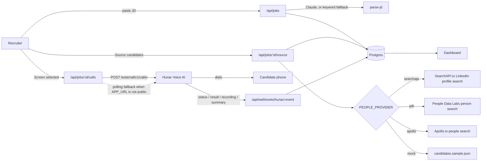

# AI Hiring Assistant

Paste a job description → source candidates with phone numbers → screen them with a
[Hunar.ai](https://api.voice.hunar.ai/docs/external/) voice agent → read the answers,
recordings, and engagement on a dashboard.

Built as one app because Parts 1 and 2 of the assignment are the same product: an
AI-driven candidate reachout with a dashboard of responses. Part 3 is answered
[below](#part-3--tracking-attendance-for-1000-people-across-100-locations-without-smartphones).

---

## Architecture



**Why both webhooks and polling.** Hunar posts results to `callback_config` URLs, which
needs a public HTTPS origin. On `localhost` there is nothing to post to, so
`GET /api/jobs/:id/calls` re-reads any in-flight call straight from Hunar before
returning. The dashboard works identically either way; it just tells you which mode
it is in.

### Data model

| Table | Purpose |
|---|---|
| `jobs` | Raw JD plus the parsed `title`, `company`, `location`, `seniority`, `skills[]` |
| `candidates` | Sourced people. Deduplicated per job on `(job_id, phone)` for candidates that have a number, and on a partial unique index `(job_id, linkedin) where linkedin is not null` for those that don't — Postgres treats NULLs as distinct, so the phone constraint alone stops deduplicating once `phone` is nullable. Either way, re-running sourcing is idempotent. |
| `calls` | One row per Hunar call, keyed by **Hunar's** call id — which makes duplicate callbacks idempotent without a mapping table. Holds status, extracted `result` JSON, recording URL, engagement, duration, and `webhook_events` (incremented only by the webhook route). |

---

## Setup

```bash
npm install
cp .env.example .env.local     # then fill it in — see the table below
npm run preflight              # verifies the Hunar key and that a from-number can dial +91
npm run db:push                # applies schema.sql (idempotent)
npm run seed:agent             # prints HUNAR_AGENT_ID; paste it into .env.local
npm run preflight              # re-run: also confirms HUNAR_AGENT_ID resolves
npm run dev
```

Run `preflight` first. `POST /external/v1/calls/` returns a `400` if the org has no
validated from-number whose `allowed_countries` includes `IN`, and that failure looks
identical to a code bug from the dashboard.

Open http://localhost:3000.

With `PEOPLE_PROVIDER=mock` (the default) and no `ANTHROPIC_API_KEY`, the only paid
key you need is `HUNAR_API_KEY`.

### Environment variables

| Variable | Required | Purpose |
|---|---|---|
| `DATABASE_URL` | yes | Postgres connection string. Supabase: use the **Session pooler** URI with `?sslmode=require`. |
| `HUNAR_API_KEY` | yes | Sent as the `X-API-Key` header on every Hunar request. |
| `HUNAR_AGENT_ID` | yes | Produced by `npm run seed:agent`. |
| `APP_URL` | for webhooks | Public HTTPS origin Hunar calls back. Leave as `http://localhost:3000` locally and the polling fallback takes over. |
| `WEBHOOK_TOKEN` | for webhooks | Secondary gate appended as `?token=…` to every callback URL. The primary control is Hunar's HMAC signature, verified with `HUNAR_API_KEY`. Generate with `openssl rand -hex 24`. |
| `PEOPLE_PROVIDER` | no | `mock` (default), `searchapi`, `pdl`, or `apollo`. |
| `SEARCHAPI_API_KEY` | only for `searchapi` | SearchAPI.io key. Finds real LinkedIn profiles but returns no phone number — those candidates are stored as not-callable. |
| `PDL_API_KEY` | only for `pdl` | People Data Labs key — free tier on signup. Search is scoped to `dataset: "mobile_phone"` so results carry a dialable number. |
| `APOLLO_API_KEY` | only for `apollo` | Apollo.io key. Phone numbers come back only on plans with phone reveal enabled; candidates without a number are dropped. |
| `ANTHROPIC_API_KEY` | no | Enables Claude-based JD parsing. Without it, parsing falls back to keyword extraction. |

`.env.local` is gitignored. No key is ever committed or logged.

### Receiving webhooks locally

```bash
ngrok http 3000
```

Put the `https://…ngrok…` URL in `APP_URL`, restart `npm run dev`, and calls launched
from then on will carry live callback URLs.

---

## Hunar integration

Everything below was verified against the live OpenAPI document at
`https://api.voice.hunar.ai/docs/external/openapi.json`.

- **Auth** — `X-API-Key: $HUNAR_API_KEY` on every request.
- **Agent** (`POST /external/v1/agents/`) — created once by `scripts/seed-agent.ts`,
  or reused if an agent with the same name already exists. Persona `NEHA`, language
  `ENGLISH`. Its `result_schema` extracts `interested`, `notice_period`,
  `expected_ctc`, `availability`, and `summary`.
- **Call** (`POST /external/v1/calls/`) — `callee_name`, `mobile_number` (E.164),
  `agent_id`, `timezone: Asia/Kolkata`, plus `custom_data` carrying `job_role`,
  `company`, and `location` into the agent's prompt variables.
- **Detail** (`GET /external/v1/calls/{call_id}/`) — the polling fallback and the
  source of truth after every webhook.
- **Statuses** — `NOT_STARTED`, `SCHEDULED`, `INITIATED`, `RINGING`, `IN_PROGRESS`,
  `COMPLETED`, `NOT_CONNECTED`, `CANCELLED`, `FAILED`. The last four are terminal, so
  the dashboard stops polling once every call reaches one.

### Webhook authentication

Hunar signs every callback: `X-Hunar-Signature` is a base64 HMAC-SHA256 over
`{X-Hunar-Timestamp}.` + the raw request body, keyed with an API key, and may carry
several comma-separated digests when an org has more than one active key. The route
verifies that signature over the **raw** body before parsing anything, rejects
timestamps outside a 300-second window to block replays, and compares in constant
time. A shared `?token=` on the callback URL is kept as a secondary gate.

The payload is then used **only to identify the call** — authoritative state is re-read
from `GET /external/v1/calls/{call_id}/`. One handler therefore covers all four
callback shapes, duplicate deliveries converge on the same result, and a partial or
malformed payload cannot corrupt a row.

Requests that cannot be acted on return **200, not 4xx**: Hunar retries 4xx and 5xx
four times with exponential backoff, and a payload that is unparseable now will still
be unparseable on retry.

`calls.webhook_events` is incremented only by this route, so a non-zero value is proof
the webhook path fired rather than the polling fallback. There is no summary column —
the `call_summary` event carries `status`, `recording_url` and `result`, but no summary
string, so one would never populate.

---

## Deploying to Vercel

1. Push the repo to GitHub and import it in Vercel.
2. Add every variable from the table above as a Vercel environment variable, with
   `APP_URL` set to your deployment's own `https://` origin.
3. Deploy, then run `npm run db:push` locally against the same `DATABASE_URL` (the
   schema is not applied automatically).
4. Launch one call to your own number and watch the row settle on the dashboard.

---

## Tests

```bash
npm test
```

18 tests, no framework — Node's built-in runner. They cover the three places where a
silent logic bug would be invisible until production:

- **Job-description parsing** (the keyword path, which is the default) — including a
  regression for an over-greedy company match that reached the *spoken* introduction.
- **Call-status handling.** The call-detail `status` is documented as "automatically
  converted to label", so Hunar may return `Not Connected` where the enum says
  `NOT_CONNECTED`. Statuses are normalized before storage; without it, terminal-state
  detection fails and the dashboard polls forever. Also covers the polling window that
  stays open after `COMPLETED` until `result` and `recording_url` arrive.
- **Webhook signature verification** — valid, tampered body, wrong key, replayed
  timestamp, multi-segment headers, and missing headers all fail closed.

### Before the live demo

Point one sourced candidate at a real number. Do this against the database, not the
sample file, so the number never enters git:

```bash
npm run set-phone -- "Rohan Mehta" +919876543210
```

Re-running sourcing will not undo it — the upsert is `on conflict do nothing`, and the
sample row's original number no longer matches that row.

---

## Part 3 — Tracking attendance for 1000 people across 100 locations without smartphones

> *If there were no smartphones but LLMs exist, how would an HR track attendance of
> 1000 people across 100 locations daily?*

**Answer: don't build an app — build a phone call.** Every one of those 100 locations
already has a working phone: a landline, a feature phone, or a shared handset. Voice is
the one interface that needs no smartphone, no data plan, no literacy assumption, and no
device rollout. An LLM voice agent — exactly what the Hunar API in this repo provides —
turns that phone into the attendance terminal.

**How it works**

1. **Register locations, not devices.** Each site has one registered phone number and a
   supervisor. Each worker has a short PIN, issued once on paper.
2. **The system calls out, on a schedule.** At the start of each shift the platform
   places an outbound call to each site — 100 calls, fanned out in parallel, the same
   bulk-dispatch shape as `POST /external/v1/calls/bulk/`. Outbound beats inbound: it
   removes "the supervisor forgot to call in" as a failure mode, and it timestamps
   itself.
3. **The agent takes a verbal roll-call.** It reads the roster for that site and the
   supervisor answers down the list. Because it is an LLM and not a DTMF tree, it
   handles "Ramesh is here but Sunita's on leave today, and we've got a new fellow
   called Imran" in one breath, in the local language, without a menu.
4. **Identity is confirmed by PIN, not by voice.** For any worker where presence is
   disputed or the site is high-risk, the agent asks that worker to come to the phone
   and speak their PIN. This is the anti-fraud control: a supervisor can claim a name,
   but cannot produce someone else's PIN on demand.
5. **Structured extraction, not a transcript.** The agent's result schema is the
   attendance record — `{ present: [], absent: [], on_leave: [], new: [], headcount }`.
   That is a database row, not prose. Same mechanism this app uses to pull notice
   period and expected CTC out of a screening call.
6. **Reconcile and escalate.** The platform compares reported headcount against the
   roster. Sites that don't answer, whose numbers don't add up, or whose PIN checks
   fail get flagged and re-dialled; only those exceptions reach a human. HR sees one
   dashboard of 100 sites, not 1000 individual pings.

**Why this holds up at 1000×100 scale.** The daily work is 100 calls of two to three
minutes each, which is a few hours of parallel machine time and zero hours of human
time. Cost scales with sites, not with headcount, so adding workers to a site is free.
The only hardware requirement is a phone that already exists at every location.

**Where it is weak, and the mitigation.** Proxy attendance is the real risk — a
supervisor answering for absent workers. PIN-on-demand raises the cost of that, and
random spot-checks (the agent asks for two randomly chosen workers to verify in person
each day) raise it further, but voice alone cannot fully prove physical presence.
Where the stakes justify it, pair the call with something cheap and physical: a rotating
code written on a whiteboard at the site, or a per-shift code the agent reads out and
requires back on the next call. Poor line quality and code-switching between languages
are the other practical failure modes; both are handled by re-dial plus routing
unresolved sites to a human, which is why the reconciliation step exists.

---

## Notes and known limits

- **Sourcing is provider-pluggable, and the providers differ in what they can return.**
  `searchapi` finds real people but no phone numbers; `pdl` and `apollo` can return
  numbers but gate them behind account tier. A candidate without a number is stored
  and shown, just not selectable for a call — the checkbox is disabled and the launch
  endpoint rejects it with a 400. Attach a number with `npm run set-phone` to screen
  someone found this way.
- **SearchAPI.io** (`PEOPLE_PROVIDER=searchapi`) queries Google restricted to
  `site:linkedin.com/in`, built from the parsed title, location and top skills. It is
  the only provider here that signs up with a personal email, which is why it is the
  one demonstrated end-to-end. Results dedupe on `(job_id, linkedin)` rather than
  phone, since SERP output has no number and varies slightly between identical queries.
- **People Data Labs** (`PEOPLE_PROVIDER=pdl`). The query is
  built from the parsed JD — title and location — and pinned to `dataset: "mobile_phone"`
  with `mobile_phone IS NOT NULL`, because a candidate without a dialable number is
  useless to a voice screener. Free-tier keys have limited credits and each returned
  record costs one.
- Apollo is implemented as a second provider, but its phone numbers require a plan with
  phone reveal enabled. Candidates without a reachable number are filtered out rather
  than stored unreachable, so an Apollo search on a free plan can legitimately return
  zero rows.
- The mock provider exists so the demo never depends on a third-party plan tier.
- Call summaries arrive only via the `summary` webhook — they are not on Hunar's
  call-detail response — so on a localhost-only run the summary column stays empty
  while every other field fills in from polling.
- `npm run db:push` applies `schema.sql` directly. There is no migration history; for a
  demo-scale app that is the right amount of machinery.
- **The app has no authentication.** Anyone who can reach the deployed URL can create a
  job and launch real, billable phone calls. That is acceptable for a reviewed demo and
  is a blocker for anything beyond one — the fix is a password gate in `middleware.ts`,
  deliberately not added here so a reviewer can open the link and use it.
- Calls are created one request per candidate rather than through
  `POST /external/v1/calls/bulk/`. Bulk is the right call above roughly fifty
  candidates; at demo scale the per-call errors are easier to surface individually.
